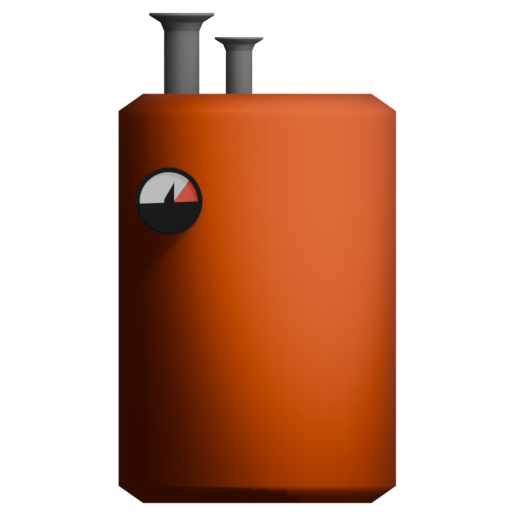

<h1>Finite Steam Machine</h1>

The creators of VoidPtr present: A language running on a (simulated) steam machine!

<h3>Welcome to the steam age of computing!</h3>

<h2>Setup</h2>

Compile the project yourself (csproj file in src) or download the pre compiled binary from releases.

The CLI expects the following arguments ([optional]):

<code>FiniteSteamMachine inputfile.belt manual_tick tick_delay_ms [-no-display] [-containers=number]</code>

<ul>
<li>manual tick: step by step code execution, usefull for debugging.</li>
<li>tick delay: delay between instructions, usefull for observing machine behaviour.</li>
<li>no display: dissables the machine state tui.</li>
<li>containers: amount of steam containers, the default value is 32</li>
</ul>

<h2>Instructions</h2>

<i>Info: Arguments enclosed in '[' ']' are written as positive or negative integers without brackets.</i>

Comments: <code>! This is a comment </code>

<table border="1" cellpadding="8" cellspacing="0">
<tr>
<th>Instruction</th>
<th>Summary</th>
<th>Arguments</th>
</tr>

<tr>
<td><code>coal [amount]</code></td>
<td>Adds coal to the boiler. Does not cost steam/pressure.</td>
<td>amount: Amount of coal in kg to be added to the boiler (&gt 0).</td>
</tr>

<tr>
<td><code>pump [amount]</code></td>
<td>Pumps water into the boiler.</td>
<td>amount: Amount of pressure to use for pumping water. Ratio: <code>water = 0.8*pressure</code> </td>
</tr>

<tr>
<td><code>set_put [value]</code></td>
<td>Sets steam press mode to constant generation.</td>
<td>Pushes given value onto the press stack. Pressure cost: 0.5 bar.</td>
</tr>

<tr>
<td><code>set_add</code></td>
<td>Sets steam press mode to addition.</td>
<td>Expects 2 values on the press stack. Pops 2 values and pushes result on press. Pressure cost: 1 bar.</td>
</tr>

<tr>
<td><code>set_mul</code></td>
<td>Sets steam press mode to Multiplication.</td>
<td>Expects 2 values on the press stack. Pops 2 values and pushes result on press. Pressure cost: 2 bar.</td>
</tr>

<tr>
<td><code>set_sub</code></td>
<td>Sets steam press mode to subtraction.</td>
<td>Expects 2 values on the press stack. Pops 2 values, [a](top) and [b](bottom), pushes [b]-[a]. Pressure cost: 1 bar.</td>
</tr>

<tr>
<td><code>set_div</code></td>
<td>Sets steam press mode to division.</td>
<td>Expects 2 values on the press stack. Pops 2 values, [a](top) and [b](bottom), pushes [b]/[a]. Pressure cost: 2 bar.</td>
</tr>

<tr>
<td><code>set_write_chr</code></td>
<td>Sets steam press mode to character output.</td>
<td>Expects 1 value on the press stack. Pops 1 value and prints it to the console as a character.</td>
</tr>

<tr>
<td><code>set_read_chr</code></td>
<td>Sets steam press mode to character input.</td>
<td>Pushes one input character from the console onto the stack on press.</td>
</tr>

<tr>
<td><code>press</code></td>
<td>Executes currently selected press mode or waits for enough pressure to built up.</td>
<td>Uses the pressure corresponding to the current mode. 
<i>Note: Due to rounding errors or other unresolved issues the press instruction expects at least 0.1 bar more to execute.</i></td>
</tr>

<tr>
<td><code>pull</code></td>
<td>Pulls one value from the press stack and prints it to the console.</td>
<td>-</td>
</tr>

<tr>
<td><code>release_valve [value]</code></td>
<td>Sets the release valve to release [value] amount of pressure per tick.</td>
<td>value: amount of pressure in 0.1 bar units (&gt 0).</td>
</tr>

<tr>
<td><code><nobr>high_pressure_switch [value]</nobr></code></td>
<td>Pauses instruction execution while pressure is below value.</td>
<td>value: amount of pressure in 0.1 bar units (&gt 0).</td>
</tr>

<tr>
<td><code><nobr>low_pressure_switch [value]</nobr></code></td>
<td>Pauses instruction execution while pressure is above value.</td>
<td>value: amount of pressure in 0.1 bar units (&gt 0).</td>
</tr>

<tr>
<td><code>set_container [index]</code></td>
<td>Sets steam container[index] as the current.</td>
<td>index: index of the container (&gt= 0).</td>
</tr>

<tr>
<td><code>load_container</code></td>
<td>Loads all steam inside the current container into the boiler. Does nothing if no container is connectd.</td>
<td>-</td>
</tr>

<tr>
<td><code>disconnect_container</code></td>
<td>Disconnects the current container. Does nothing if no container is connectd. Not necessary for switching containers.</td>
<td>-</td>
</tr>

<tr>
<td><code>move_belt [number]</code></td>
<td>Skipped if pressure is 0 when reaching instruction. 
Tries to move the instruction belt by a given number. Costs 1 bar per moved instruction.
If pressure is insufficient, program execution continues at the reached position.
</td>
<td>Positive values move the instruction counter towards the end of a file, 
negative values move the counter towards the start of the file.</td>
</tr>

<tr>
<td><code><nobr>switch_belt [filename | beltID]</nobr></code></td>
<td>Switches execution state to a different belt. 
The program counter is saved and execution is resumed at the saved program counter when switching to a belt.
If the end of a belt is reached without a switch, program execution ends. 
If the target belt's program counter is at the end when switched to, the counter gets reset.</td>
<td>Filename: Name/path (without spaces!) of a file relative to the main file. 
All file names get replaced by belt ids during compilation.</td>
</tr>

<tr>
<td><code>push_belt_number</code></td>
<td>Pushes the current belt id on the press stack.
</td>
<td>-</td>
</tr>

</table>

Note: all instructions accepting arguments also accept <code>pull</code> as a possible argument. 
If provided, it pops a value of the press stack and uses it as the input value.

<h2>Understanding the Machine</h2>

To start working with the machine, you first have to understand what the levers and switches even do. 
This is a lot to take in at once, so feel free to skim over this part and look at the examples.

The steam machine being simulated isn't very realistic. 
This language is supposed to be less of a simulation than a new perspective and chalange on programing.
That's why instructions use just pressure as their requirements and pressure drops by the required amount.
This was instroduced to make dealing with the machine easier, it already is complex enough in its simplified form.

The machine consists of the following components:

<ul>
<li>A boiler holding water, coal and steam</li>
<li>A steam press using pressure to perform operations on the press anvil</li>
<li>A water pump which uses pressure to pump more water into the boiler</li>
<li>Multiple steam containers used to store steam for later use</li>
<li>Belts which transport instructions</li>
</ul>

<h3>Steam Press</h3>

The steam press is a state machine which uses a stack for its operations.

Set instructions e.g. <code>set_add</code> set the current state
and the <code>press</code> instruction executes the current state. Most instructions pop values off the stack.

The amount of pressure needed for one <code>press</code> depends on the selected state.

<table border="1" cellpadding="8" cellspacing="0">
<tr>
<th>State</th>
<th>Cost</th>
</tr>

<tr>
<td><code>set_put</code></td>
<td>0.5bar</td>
</tr>

<tr>
<td><code>set_write_chr</code></td>
<td>1bar</td>
</tr>

<tr>
<td><code>set_add</code></td>
<td>1bar</td>
</tr>

<tr>
<td><code>set_sub</code></td>
<td>1bar</td>
</tr>

<tr>
<td><code>set_mul</code></td>
<td>2bar</td>
</tr>

<tr>
<td><code>set_div</code></td>
<td>2bar</td>
</tr>

</table>

<h3>Water Pump</h3>

<code>pump [bar]</code> 

The water pump uses pressure to pump water.

The conversion rate from pressure to water is <code>added_water = pressure*0.8</code>.

<h3>The Boiler</h3>

This is the most important component of the steam machine.

The boiler generates steam and thus pressure every tick (before every instruction).
It has a maximum pressure at which it explodes and throws a <code>BoilerExplosion</code> exception (default: 150bar). 
Steam is generated if you have coal and water inside the boiler.

<b>Every Tick:</b>

Burns one coal: 
<code>coal = coal - 1</code>

Steam generated by the heat the coal releases: 
<code>new_steam = 0.1*(coal*coal)</code>

Reduces water by the steam amount (if possible, else: reduces steam output): 
<code>new_steam = 0.1*(coal*coal)</code>

Steam creates pressure: 
<code>pressure = pressure + new_steam/2</code>

Don't worry, depending on what program you are writing, exact values won't be required. 
This information is here in case you do want to write something more complicated. 

<h3>Control Valves</h3>

Control valves allow you to manage pressure when needed.

<code>high_pressure_switch [value/10 bar]</code> 

The high pressure switch pauses instruction execution while the pressure is less than the given value. 

<code>low_pressure_switch [value/10 bar]</code> 

The low pressure switch pauses execution while the pressure is above the given value.

<code>release_valve [value/10 bar]</code> 

The release valve releases the given pressure every tick, if a container is conected, the pressure is transfered there.

<i>Note: All valve values are expecting 1/10 bar as the standart unit.</i>

<h3>Steam Containers</h3>

Steam containers can be used to store an unlimited amount of steam. 
The release valve removes a given amount of steam per tick, if a container is selected <code>set_container [index]</code>,
the steam gets transported into the currently selected container. 

<code>load_container</code> loads all of the steam stored in the current container back into the boiler.

You can disconnect a container with <code>disconnect_container</code>.

<h3>Instruction Belts</h3>

Every FiniteSteamMachine file represents one transport belt holding instructions. 

Each belt gets assigned a numerical ID which can be pushed on the press stack with <code>push_belt_number</code>.

You can switch belts with <code>switch_belt [filename | beltID]</code>.
<i>Note: file names get resolved to numerical IDs during compile time.</i>

A belt stores its current program counter when switching to another belt. 
Program execution stops when the end of the current belt is reached.
If the belt the program switches to is at its end, the belt's program counter gets reset.

<h3>Move Instruction</h3>

The <code>move_belt [number]</code> instrucion moves the current instruction belt by 1 instruction per tick
for the given amount. Negative numbers move the belt up (towards lower line count), positive numbers move the belt down (towards higher line count). One moved instruction costs 1 bar of pressure, if pressure is not sufficient,
the belt continues execution at the reached instruction. Instructions do not get executed during move.

If the <code>move_belt</code> instruction is reached while pressure is below 1 bar, the instruction gets skipped. 
If the move instruction reaches the start of a file, execution continues from there. 
If the move instruction reaches the end of a file, the machine halts.

